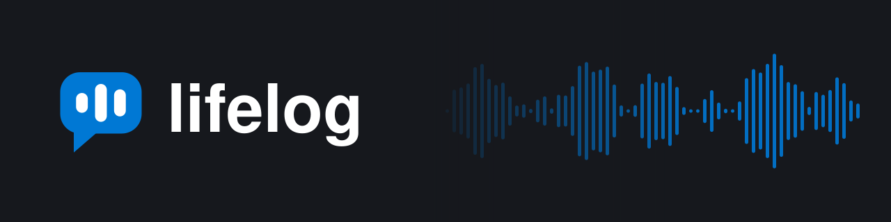

An always-on, local, searchable transcript of what is said and heard on this PC: your mic and every app that plays
sound, each as its own stream, transcribed on the GPU. Each evening a local AI writes a summary of the day.
Nothing leaves the PC. Design and roadmap: [PLAN.md](PLAN.md).

## Parts

- `src/`: the recorder (WASAPI mic and per-app loopback), the tray icon, the local API and the `lifelog.exe` CLI.
- `ui/`: builds `lifelogw.exe`, the app itself. Recording runs on background threads and the
  [immediate-mode](https://github.com/emilk/immediate-mode) window runs on the main thread.
- `worker/`: Python, transcribes with faster-whisper (large-v3-turbo) into SQLite (`schema.sql`). It steps aside
  while a game is running and catches up after.
- Daily summary: a [llama.cpp](https://github.com/ggml-org/llama.cpp) server with Qwen3 14B, only running while it
  writes.

## Setup

```powershell
python -m venv worker\.venv
worker\.venv\Scripts\python.exe -m pip install -e worker
scripts\install.ps1    # build, install, start now and at login; also fetches the summary AI (~10 GB)
```

Run `install.ps1` again to update; `-Uninstall` removes the app but keeps the data. Settings live in
`%APPDATA%\lifelog\config.toml`, and the log in `%LOCALAPPDATA%\lifelog\lifelog.log`.

## Use

- **Tray:** blue means listening. Left-click for the menu (pause, copy the last few minutes as a file, text or audio,
  paste files or links into the timeline). Right-click to pause or quit.
- **Timeline:** one page per day, searchable. Lines from the last 7 days can be played back.
- **Journal:** the daily summaries, a calendar, and reminders for things you said you'd do.
- **Settings:** which apps to record, which are games, when to transcribe, and the summary time.

From a terminal or a Stream Deck:

```powershell
lifelog clip 15m             # or 1h, 2d, today
lifelog toggle               # private mode; also pause, resume
lifelog exclude spotify.exe  # stop recording an app; "include" undoes it
lifelog summary now          # or later, skip
lifelog status
```

The local API is on `127.0.0.1:47800` (`/status`, `/pause`, `/resume`, `/toggle`, `/clip?range=15m`).

## Privacy

- Get consent from the people you record. Excluded apps and private mode record nothing, and private mode drops
  the sentence in progress.
- Audio is kept for 7 days for playback and then deleted; the text stays.

## Contributing

GitHub is a mirror that is overwritten on every sync. To send a change, fork it and open a pull request; it gets
merged on the main copy. Don't merge pull requests on GitHub.
